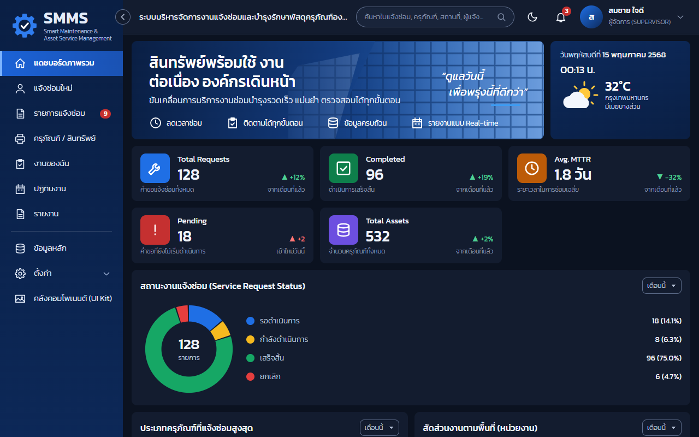
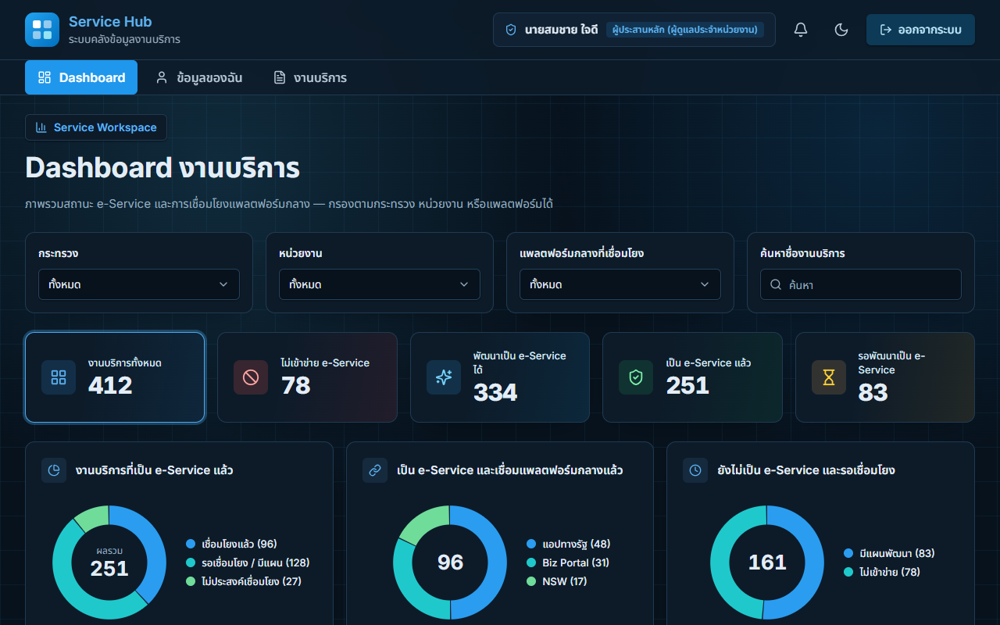
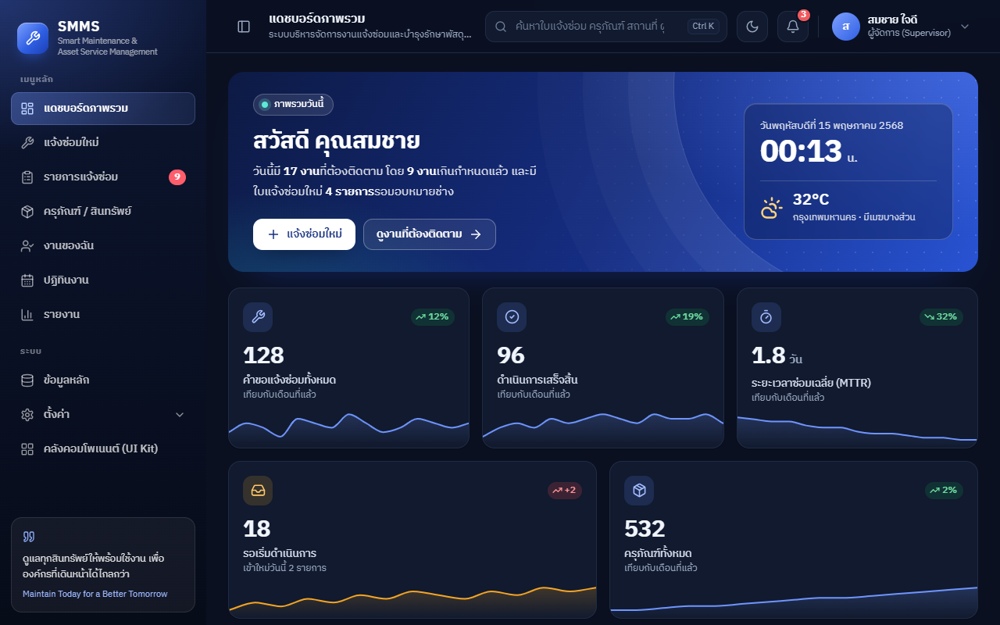
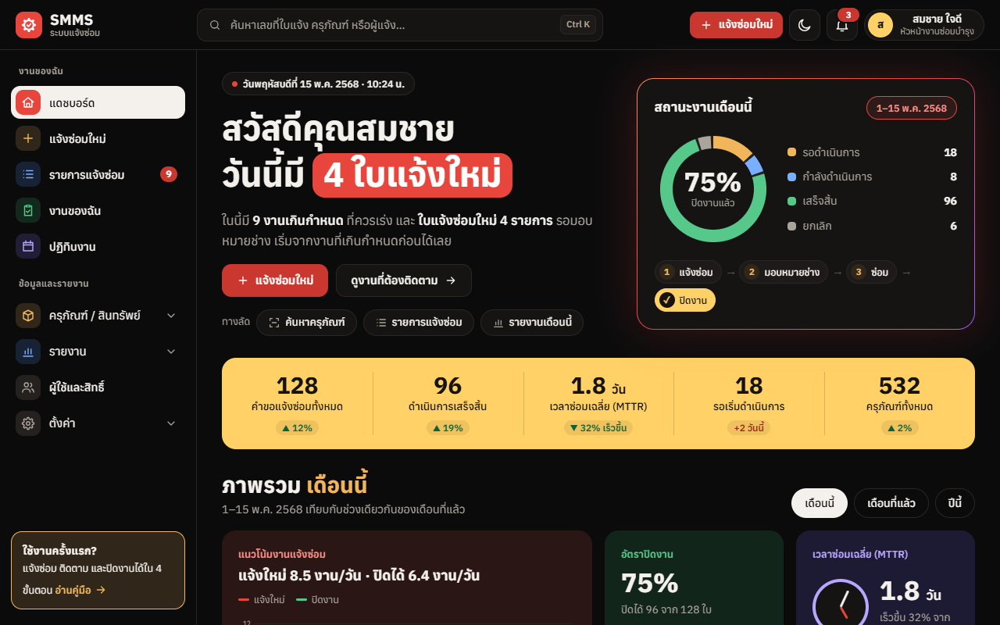

# UI Template สำหรับระบบงานภายในองค์กร

ชุด UI template 4 แบบ สำหรับใช้เป็น "แบบ" ให้ AI (เช่น Claude Code) สร้างระบบใหม่ หรือปรับหน้าจอระบบเดิมให้หน้าตาเหมือนกันทั้งระบบ

- เป็น HTML + CSS + JavaScript ล้วน ไม่ต้อง build และไม่พึ่ง framework
- แต่ละชุดมี CSS 1 ไฟล์ + JS 1 ไฟล์ แยกจากกันเด็ดขาด
- รองรับมือถือ และสลับโหมดมืด/สว่างได้
- **1 ระบบเลือกใช้ 1 ชุด**

## เลือก template

| ชุด | หน้าตา | ฟอนต์ | คลาส / JS | หน้าที่มี | สถานะ |
|---|---|---|---|---|---|
| [Template 1](template1/) | ทางการ เมนูซ้ายสีน้ำเงินกรมท่า ข้อมูลแน่นแบบ dashboard | Kanit | `ds-` / `window.DS` | 8 หน้า + หน้ารวมคอมโพเนนต์ + ตัวอย่างหน้า intranet | ครบชุด |
| [Template 2](template2/) | เมนูแบบแท็บด้านบน สีฟ้าสด พื้นลายตาราง | Inter + Noto Sans Thai | `t2-` / `window.T2` | หน้าแรก, login, dashboard, list, form | ครบชุดหลัก |
| [Template 3](template3/) | ออกแบบ Template 1 ใหม่ให้ดูนุ่มและเรียบขึ้น | IBM Plex Sans Thai | `t3-` / `window.T3` | dashboard | ตัวอย่าง (ยังไม่ครบ) |
| [Template 4](template4/) | โทน "สตูดิโอ" อบอุ่น พื้นครีม/ดำ สีแดงคอรัล กล่องแดงเน้นคำ แถบตัวเลขสีเหลือง | Anuphan | `t4-` / `window.T4` | 8 หน้า | ครบชุด |

### Template 1 — DS UI Kit



- หน้า: `dashboard` `list` `form` `detail` `login` `error` `print` `starter` `components` + [`examples/intranet.html`](template1/examples/intranet.html)
- คู่มือสำหรับ AI: [`AI-UI-GUIDE.md`](AI-UI-GUIDE.md) (กฎ คลาส JS API checklist) และ [`PROMPTS.md`](PROMPTS.md) (prompt สำเร็จรูป) อยู่ที่ root ของ repo
- คู่มือ 2 ไฟล์นี้เขียนไว้ก่อนย้ายไฟล์เข้าโฟลเดอร์ `template1/` จึงยังอ้าง path แบบเก่า เวลาใช้ให้อ่านเป็นแบบใหม่:

  | ในคู่มือเขียนว่า | ที่อยู่จริง |
  |---|---|
  | `template\pages\` | `template\template1\pages\` |
  | `/template/assets/ds-ui.css` | `/template/template1/assets/ds-ui.css` |

### Template 2 — Service Hub



- หน้า: `index` (หน้าแรกก่อน login) `login` `dashboard` `list` `form`
- คู่มือ + prompt สำเร็จรูป: [`template2/README.md`](template2/README.md) (หัวข้อ 10)

### Template 3 — SMMS แบบใหม่ (ตัวอย่าง)



- ตอนนี้มีเฉพาะ `dashboard` ไว้ดูหน้าตาก่อนตัดสินใจทำหน้าที่เหลือ
- ยังไม่มีคู่มือ จึงยังไม่เหมาะให้ AI ใช้สร้างระบบจริง

### Template 4 — สตูดิโอ



- หน้า: `dashboard` `list` `form` `detail` `login` `error` `print` (เอกสาร A4) `starter`
- มีเมนูย่อย, select แบบพิมพ์ค้นหา, ปฏิทินไทย (พ.ศ.), ตรวจช่องบังคับในฟอร์ม, หน้าต่างยืนยัน
- คู่มือ + prompt สำเร็จรูป: [`template4/README.md`](template4/README.md) (หัวข้อ 10)

## โครงสร้าง repo

```
template/
├─ README.md            หน้านี้
├─ AI-UI-GUIDE.md       คู่มือ AI ของ Template 1
├─ PROMPTS.md           prompt สำเร็จรูปของ Template 1
├─ docs/screenshots/    ภาพหน้าจอในหน้านี้
├─ template1/           assets/ (ds-ui.css, ds-ui.js) · pages/ · examples/
├─ template2/           README.md · assets/ (t2-ui.css, t2-ui.js, logo.svg) · pages/
├─ template3/           assets/ (t3-ui.css, t3-ui.js) · pages/dashboard.html
└─ template4/           README.md · assets/ (t4-ui.css, t4-ui.js) · pages/
```

## เปิดดูตัวอย่าง

clone ไว้ในโฟลเดอร์เว็บของ IIS:

```bash
git clone https://github.com/NarakTH/template.git C:\inetpub\wwwroot\template
```

แล้วเปิด `http://localhost/template/template4/pages/dashboard.html` (เปลี่ยน `template4` เป็นชุดที่ต้องการ)

หรือดับเบิลคลิกไฟล์ `.html` ใน `pages/` เปิดในเบราว์เซอร์ได้เลย เพราะทุกหน้าอ้างไฟล์ CSS/JS แบบ relative (`../assets/`)

## ใช้กับ AI

1. เลือก template 1 ชุดสำหรับระบบนั้น
2. เปิด Claude Code ในโฟลเดอร์ของระบบ แล้วคัดลอก prompt สำเร็จรูปของชุดนั้นไปวาง:
   - Template 1 → [`PROMPTS.md`](PROMPTS.md)
   - Template 2 → [`template2/README.md`](template2/README.md) หัวข้อ 10
   - Template 4 → [`template4/README.md`](template4/README.md) หัวข้อ 10
3. แทนค่าในวงเล็บ `{...}` ให้ครบ เช่น ชื่อระบบ, stack, ฐานข้อมูล, รายการหน้า
4. ให้ AI ทำทีละขั้น วางแผนก่อน แล้วทำ layout กลาง แล้วจึงทำทีละหน้า และสำรองหรือ commit งานเดิมก่อนเริ่มเสมอ

ถ้าไม่อยากใช้ prompt เต็ม อย่างน้อยให้สั่งแบบนี้ (ตัวอย่างใช้ Template 4):

```text
พัฒนาระบบ "{ชื่อระบบ}" ({ระบบทำอะไร ใครใช้})
UI ทั้งหมดใช้ Template 4 ที่ C:\inetpub\wwwroot\template\template4\ เท่านั้น
ก่อนเริ่ม อ่าน template4\README.md ทั้งฉบับ และดูหน้าต้นแบบใน template4\pages\
ทุกหน้าเลือกหน้าต้นแบบที่ใกล้ที่สุดแล้วลอกโครง markup ใช้เฉพาะคลาส t4- และ token --t4-*
ห้ามออกแบบ UI เอง และห้ามใช้ข้อความตัวอย่างของ template (SMMS, ชื่อคน, ตัวเลข) ในระบบจริง
```

## ข้อควรรู้

- **ห้ามผสมชุด:** คลาส `ds-` `t2-` `t3-` `t4-` และไฟล์ CSS/JS ของแต่ละชุดใช้ร่วมกันไม่ได้
- **ข้อมูลสมมติ:** ชื่อระบบ (SMMS, Service Hub), ชื่อคน, อีเมล, เลขที่เอกสาร และตัวเลขทั้งหมดในหน้าตัวอย่างเป็นข้อมูลสมมติ ต้องแทนด้วยข้อมูลจริงก่อนใช้งาน
- **ฟอนต์:** ทุกชุดโหลดฟอนต์จาก Google Fonts เครื่องที่ไม่มีอินเทอร์เน็ตต้องเก็บไฟล์ฟอนต์ไว้ในระบบเอง
- **ค่าที่จำในเบราว์เซอร์:** โหมดสี การย่อเมนู และเมนูย่อยที่เปิดค้างไว้ จำไว้ใน `localStorage` (เช่น `t4-theme`, `t4-nav`)
- **ที่มาของหน้าตา:** Template 2 ได้แรงบันดาลใจจาก gsd.opdc.go.th และ Template 4 จาก tubhool.com โดยไม่ได้นำโลโก้ ข้อความ หรือรูปของต้นฉบับมาใช้ รายละเอียดอยู่ในหัวข้อ 1 ของ README แต่ละชุด
